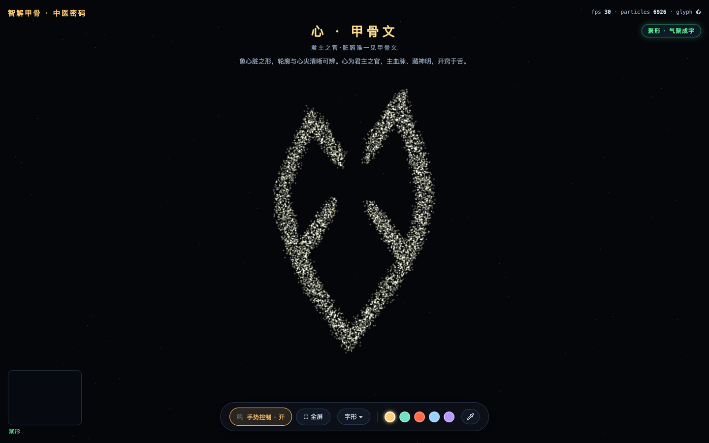

# 甲骨文 · 中医密码

以手势引气，让三千年前的甲骨文在三维粒子星云中聚形 —— 每个字，都藏着一段中医密码。



**完全离线可运行 · 无任何 CDN 依赖 · 无摄像头也能玩**

## 这是什么

《智解甲骨·中医密码》—— Three.js 7000 粒子点云 + MediaPipe 手势追踪的单文件网页交互作品。摄像头手势：

| 手势 | 效果 |
| --- | --- |
| 拇指食指捏合 | **聚形**：散落的星云气聚成甲骨文 |
| 张开手掌 | **气散**：字化气回归星云 |
| 捏着左右/上下移动 | **转动视图**：位置跟随（像方向盘），手到哪转到哪；满角左右 ±66°、上下 ±60° |
| 半握移动 | 牵引星云 |
| 双手 | 各带一枚气引点 |

无摄像头时自动回退鼠标模式：按住 = 捏合聚形，松开 = 气散；鼠标是相对设备，仍为「拖动＝旋转」。

聚形收敛期间视图锁定为正视（成字那一瞬一定是正的），成字后才交还转动控制权。左下角为实时手部骨架（不显示相机画面）。

## 快速开始

摄像头手势必须在 `http://` 或 `https://` 下运行（`file://` 会被浏览器拦截：Safari 在 `file://` 下允许摄像头，却禁止 `fetch` 本地 wasm，报错只有一句 "Load failed"）：

```bash
python3 serve.py 8138
# 浏览器打开 http://localhost:8138/gesture3d.html
```

`serve.py` 是无缓存、多线程的静态服务器（只依赖标准库）。页面对此有前置拦截：在 `file://` 下点击「手势控制」会直接提示改用 HTTP，而不是抛出一句看不懂的报错。

用 `python3 -m http.server 8138` 也能跑，但浏览器容易吃缓存，且它是单线程、一个挂起连接就会让整站停止响应，不推荐。

## 字形库（字表收录 67 个，面板可选 64 个；全部经合并字表查证）

- **脏腑五行**：心（脏腑唯一见甲骨文）、木、水、火、土
- **四窍**：目（肝）、舌（心）、鼻（肺）、耳（肾）
- **身体与疾病**：疾（人卧床中矢）、龋（最早疾病记载）、齒、孕、腹、乳、母、女、首、面、囟（近"脑"）、息、见（人目正视·望诊之根）
- **医之源**：酉（医酒同源）、鬯、石（砭石刺病）、壶（悬壶济世）、虫（虫类药）、桑（桑叶入药）、麥（浮小麦养心敛汗）
- **天人自然**：风（百病之长）、雨、云、泉、兑（卦象为泽，山泽通气）、立、生（生生不息）、光（人举火照物）
- **具象物象**：马、牛、羊、虎、象、龙、鱼、燕、鳖（鳖甲入药·滋阴潜阳）、鹿（鹿茸入药）、车、舟、鼎、禾、黍、豕（六畜之一）、鼠（子时之鼠）
- **文明器物**：玉（玉石安神）、贝（贝币药市）、矢（疾之所由）、冊（典册医籍）、朋（两串贝玉相系）、卜（灼龟问吉凶）、岁（年谷之成）、狩（冬猎为狩）、用、兄（长兄如父）

> 肝、脾、肺、肾、医等字殷墟甲骨文未收录（后世字），字库中不以拟古字冒充。

> **关于「收录 67 / 可选 64」**：`子`、`田`、`一` 三个字已取好码位并内嵌在子集字体中，但在页面里标了 `hidden`，不显示为面板按钮（保留备用）。想放出来就把对应条目的 `hidden: true` 删掉，面板与右上角的计数会自动更新。

## 操作速查

- 字库：控制条「字形 ▾」→ 64 字面板 + 任意汉字楷体输入；选完自动收起
- 颜色：五色预设（金青朱玉紫）+ 吸管自定义；实时写入顶点色
- 全屏：控制条「⛶ 全屏」
- 待机 14 秒自动巡下一字；手动选字后计时重置

## 目录结构

| 路径 | 说明 |
| --- | --- |
| `gesture3d.html` | 主页面。字体子集与字库全部内嵌，自包含 |
| `libs/` | Three.js r152 与 MediaPipe Hands 本地运行时（约 28MB） |
| `data/` | 字表数据库（1530 已释甲骨文）与介绍文案 |
| `add_glyphs.py` | 扩充字库脚本 |
| `serve.py` | 无缓存本地服务器（可选）：`python3 serve.py [端口]`，默认 8138，仅本机用 `--host 127.0.0.1` |

## 扩充字库

```bash
python3 add_glyphs.py 牛 虎 鹿
```

从 `data/oracle_glyphs_full.json` 取码位，重新子集化 `libs/AYJGW.ttf` 并注入页面（需要 `pip install fonttools`）。字必须在数据库中，刷新页面即可生效。

## 部署到 GitHub Pages

仓库 **Settings → Pages → Deploy from a branch** 选 `main` / `(root)` 即可。Pages 自带 HTTPS，摄像头手势在线上可直接使用。

## License 与致谢

- 本项目代码以 [MIT](LICENSE) 许可发布；第三方字体与数据各自按其许可发布，状态见 [THIRD-PARTY-NOTICE.md](THIRD-PARTY-NOTICE.md)
- 甲骨文字形数据：[甲骨文AI协同平台](https://jgwlbq.org.cn)（甲骨文合并字表）
- 甲骨文字体：AYJGW
- 渲染与手势：[Three.js](https://threejs.org)（MIT）、[MediaPipe Hands](https://developers.google.com/mediapipe)（Apache 2.0）
