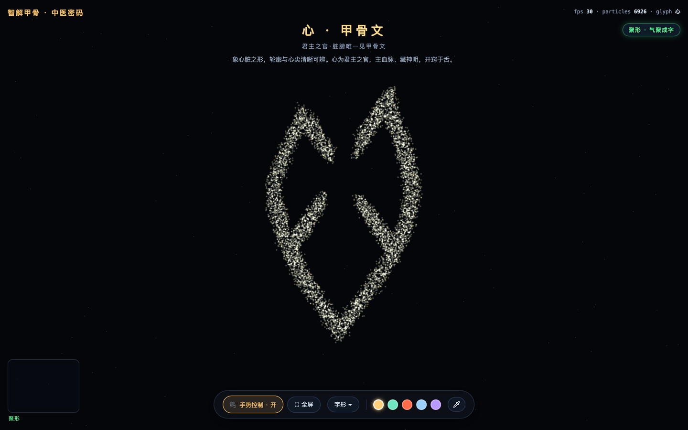
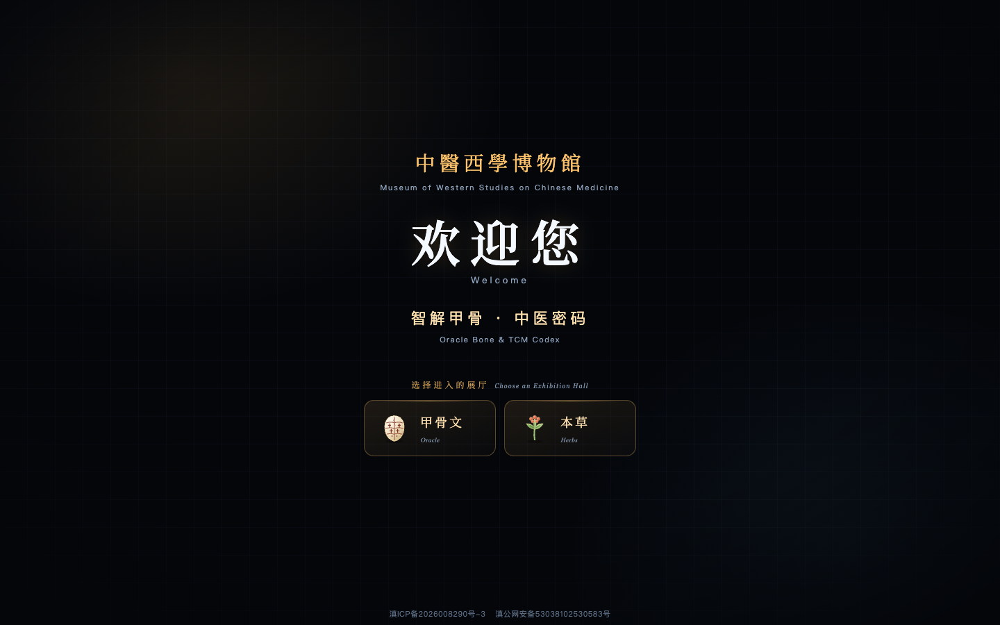
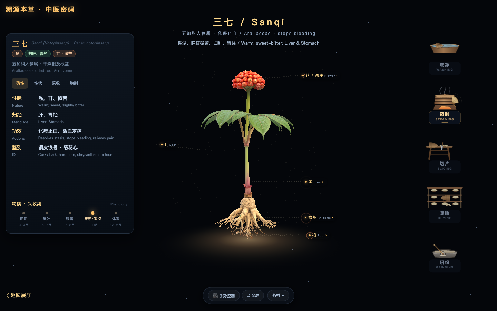

# 甲骨文 · 中医密码

以手势引气，让三千年前的甲骨文在三维粒子星云中聚形 —— 每个字，都藏着一段中医密码。



**自建站完全离线可运行 · 无外部 CDN 依赖 · 无摄像头也能玩**（`file://` 手势需联网走 CDN）



**在线试玩：[oracletcm.com](https://oracletcm.com/)** —— 阿里云轻量应用服务器（SWAS）自建站点，HTTPS，ICP 备案号 滇ICP备2026008290号-3，公安联网备案号 滇公网安备53038102530583号。
备用入口：[haikethreat.github.io/Oracle-bone-TCM](https://haikethreat.github.io/Oracle-bone-TCM/) —— GitHub Pages 托管，免备案（三七 9.2MB / 白芷 44MB 等大模型在 Pages 上被限速，手势体验首选主站）。
扉页约 5KB（gzip）；进入展厅约 1.1MB（gzip）；中药展厅首次再下约 9.2MB 三七模型，白芷模型约 44MB（gzip 后约 19MB，打开「药材 ▾」菜单时预取）；「手势控制」需再下约 16MB 模型，点按钮才触发。见下文[方式一](#方式一github-pages)。

## 这是什么

《智解甲骨·中医密码》—— Three.js 粒子点云 + MediaPipe 手势追踪的单文件网页交互作品。站点由独立扉页 `index.html` 进入两个展厅：

| 展厅 | 内容 |
| --- | --- |
| **甲骨文** | 7000 粒子字形层：字库、任意字、五色、待机巡字 |
| **中药** | 三七（150k 面 PBR 写实 GLB、菊花心断面/饮片/皂苷）、雪上一枝蒿（程序化实体网格 + PBR 贴图、块根/花序特写）与白芷（10 块网格 PBR 写实 GLB、复伞形花序/根切面）；药材属性卡内切换 |

两个展厅共用同一套场景与手势输入，进入后左下角「‹ 返回展厅」可回到扉页重新选择。甲骨文展厅的摄像头手势：

| 手势 | 效果 |
| --- | --- |
| 拇指食指捏合 | **聚形**：散落的星云气聚成甲骨文 |
| 张开手掌 | **气散**：字化气回归星云 |
| 捏着左右/上下移动 | **转动视图**：位置跟随（像方向盘），手到哪转到哪；满角左右 ±66°、上下 ±60° |
| 半握移动 | 牵引星云 |
| 双手 | 各带一枚气引点 |

无摄像头时自动回退鼠标模式：按住 = 捏合聚形，松开 = 气散；鼠标是相对设备，仍为「拖动＝旋转」。

聚形收敛期间视图锁定为正视（成字那一瞬一定是正的），成字后才交还转动控制权。左下角为实时手部骨架（不显示相机画面）。

## 中药展馆



从扉页选「中药」，或直接打开 `https://oracletcm.com/herb`（本地开发用 `gesture3d.html?mode=herb`）。展馆按「药材实体 + 属性卡 + 炮制演示」组织：中间是 3D 药材，属性卡在桌面端常驻左侧、手机/平板竖屏收为底部抽屉，左右两侧滚动演示炮制工序。

### 三味药材

| 药材 | 模型与看点 | 入药部位 |
| --- | --- | --- |
| **三七** | 约 150k 面 PBR 写实 GLB；铜皮铁骨、菊花心断面，含 2K 颜色/法线/金属粗糙度贴图 | 根及根茎；果实、叶、茎可点开识别 |
| **雪上一枝蒿** | 程序化实体网格 + PBR 贴图；纺锤形块根、盔状花、掌状深裂叶；含乌头碱，有大毒 | 块根；花序可点开识别 |
| **白芷** | 10 块网格 PBR 写实 GLB（约 44MB）；白色复伞形花序、二至三回羽状分裂叶、中空茎、长圆锥形根；花序/叶/根切面 | 根（干燥根）；花序、叶、茎可点开识别 |

> 三七以根及根茎入药；果实、叶、茎是识别部位，不是《中国药典》规定的药用部位。白芷以干燥根入药；花序、叶、茎同样是识别部位，不作药用。雪上一枝蒿有大毒，属性卡「警示」行会明确标注，内服须炮制并遵医嘱；白芷亦标有「阴虚血热者慎用，不宜与藜芦同用」。

### 操作

| 操作 | 效果 |
| --- | --- |
| 拖动植株 | 旋转观察角度；植株位置固定，不会被拖走 |
| 滚轮 / 触控板双指 / 触屏双指 | 以落点为支点缩放（单次限幅 ±10%，最大约 2.35×） |
| 点击「根茎 / 果实 / 叶 / 茎」等标签 | 打开部位特写或识别说明；入药部位同时进入讲解卡 |
| 捏合放大到 ≥1.55× 后松手 | 进入落点附近的果实 / 块根特写 |
| 底部「药材 ▾」 | 在三七 / 雪上一枝蒿 / 白芷之间切换 |
| 属性卡分页 | 药性、性状、采收、炮制；底部物候轴标出当前采收期 |
| 左右两侧工序 | 三七：洗净 / 蒸制 / 切片 / 晾晒 / 研粉；雪上一枝蒿：洗净 / 酒炙 / 甘草制 / 晒干；白芷：洗净 / 切片 / 干燥 / 研末；点开看说明 |

### 部位特写

- 进入采用「单段一镜到底」：同一块网格从整株上的原位滑到特写构图，讲解卡、化学式、化学结构、药物切面同时出现。
- 特写里**植株位置固定**，拖动只改变观察角度；化学式、化学结构、药物切面可以单独拖动。
- 关闭：桌面点右上角「×」，手机点左上角「返回展厅」；退出时直接恢复整株并快速淡入，不做缩小拼接。
- 三七：根茎（菊花心、皂苷 Rg1/Rb1）、果实（果皮与种子切面、皂苷）、叶（叶片横切、黄酮）、茎（维管束、纤维/导管、皂苷微量）。
- 雪上一枝蒿：块根（乌头碱、白色粉性断面）、花序（盔状花）。
- 白芷：根（形成层环与棕色油点）、复伞形花序（小花与花萼）、叶（叶片横切、叶脉）、茎（维管束）。

### 手机 / 平板竖屏

- 属性卡默认收起为底部抽屉，点卡头展开；展开后整张卡可纵向滚动，底部「物候 · 采收期」不会被裁掉。
- 部位特写讲解卡默认只显示标题，点标题或右上箭头展开/收起；手机不显示关闭「×」，用左上角返回收起。
- 特写里的信息标签在手机上改为短中文并自动钳进屏幕；iPad 竖屏（≤900px）同样使用底部抽屉，整株模型按视口比例缩放，不会被左右裁掉。

## 快速开始

摄像头手势必须在 `http://` 或 `https://` 下运行（`file://` 会被浏览器拦截：Safari 在 `file://` 下允许摄像头，却禁止 `fetch` 本地 wasm，报错只有一句 "Load failed"）：

```bash
cd /path/to/甲骨文      # 必须在项目目录下执行：serve.py 是相对路径
python3 serve.py 8138
# 浏览器打开 http://localhost:8138/（新扉页，选择展厅）
```

macOS 上还可以直接**双击**项目根目录的 [`启动本地服务.command`](启动本地服务.command)：
它会自动切到本目录、检测端口是否已占用、起服务并打开浏览器。同目录另有一份
`启动本地服务（仅本机）.command`，只监听 `127.0.0.1`，在不可信 Wi-Fi 下用这个。
关掉终端窗口服务就停了 —— 请用 Control-C 退出，别直接强杀，否则残留进程会占着 8138 端口，
下次双击会误报「端口被占用」。

**为什么 `http://localhost` 明文也能拿到摄像头**：按 W3C《Secure Contexts》规范 3.1 节，
host 为 `localhost`（以及 `127.0.0.0/8`、`::1/128`）的源被视为「潜在可信」，
故明文 HTTP 下同样是安全上下文，`navigator.mediaDevices` 存在。
换成局域网 IP（如 `http://192.168.1.5:8138`）就**不是**安全上下文，手势会失效 ——
这是浏览器规则，与本项目无关。

`serve.py` 是无缓存、多线程的静态服务器（只依赖标准库）。直接双击 `index.html` 也能看两个展厅（三七/白芷写实模型分别由 `libs/sanqi_model_fallback.js`、`libs/baizhi_model_fallback.js` 内嵌后备加载）；`file://` 下本地 `libs/` 的 wasm 被 CORS 拦截，联网时手势会自动改走 npm CDN，断网则请用上面的 HTTP 方式。

用 `python3 -m http.server 8138` 也能跑，但浏览器容易吃缓存，且它是单线程、一个挂起连接就会让整站停止响应，不推荐。

## 字形库（面板 1066 个单字，可选 1063 个；全部经合并字表查证）

- **脏腑五行**：心（脏腑唯一见甲骨文）、木、水、火、土
- **四窍**：目（肝）、舌（心）、鼻（肺）、耳（肾）
- **身体与疾病**：疾（人卧床中矢）、龋（最早疾病记载）、齒、孕、腹、乳、母、女、首、面、囟（近"脑"）、息、见（人目正视·望诊之根）
- **医之源**：酉（医酒同源）、鬯、石（砭石刺病）、壶（悬壶济世）、虫（虫类药）、桑（桑叶入药）、麥（浮小麦养心敛汗）
- **天人自然**：风（百病之长）、雨、云、泉、兑（卦象为泽，山泽通气）、立、生（生生不息）、光（人举火照物）
- **具象物象**：马、牛、羊、虎、象、龙、鱼、燕、鳖（鳖甲入药·滋阴潜阳）、鹿（鹿茸入药）、车、舟、鼎、禾、黍、豕（六畜之一）、鼠（子时之鼠）
- **文明器物**：玉（玉石安神）、贝（贝币药市）、矢（疾之所由）、冊（典册医籍）、朋（两串贝玉相系）、卜（灼龟问吉凶）、岁（年谷之成）、狩（冬猎为狩）、用、兄（长兄如父）

> 肝、脾、肺、肾、医等字殷墟甲骨文未收录（后世字），字库中不以拟古字冒充。

> **关于「1066 / 可选 1063」**：`子`、`田`、`一` 三个字已取好码位并内嵌在子集字体中，但在页面里标了 `hidden`，不显示为面板按钮（保留备用）。想放出来就把对应条目的 `hidden: true` 删掉，面板与计数会自动更新。
>
> 数据表另有 155 条**多字条目**（`又/右/有/侑/佑/祐`、`月/夕` 这类同码位异体，以及 `祖乙`、`妣庚` 这类合文），**不进面板列表**：一个码位只对应一个字形，整条列出会显示成一长串、渲染时还会在同一画布上画多处文字互相遮挡。这些条目里每个字都收进了别名表，因此**输入单字照常能查到甲骨文**（如输入「右」→ U60491、「月」→ U605E0）。
>
> 面板按「人工编排的 67 字优先、其余按字表顺序」排列 —— 因为待机会自动巡下一字（每字约 18.4 秒），若让 1100 多个通用字混在前面，开场先看到的会是「一」「丁」「乙」这类与中医无关的字，精心挑的那批反被淹没。

## 操作速查

- 字库：控制条「字形 ▾」→ **左侧列表栏**（每行 = 字形 + 标题 + 简介，像阅读列表；可滚动，临近底部自动续载）+ 搜索（字 / 拼音 / 释义）
- 点列表条目 → 显示该字形；**再点同一条 → 隐藏**（标题与释义一并清空）。面板不自动收起，便于连续切换
- 底部「任意字·楷体」输入：**先查字库** —— 若该字有甲骨文字形，就用甲骨文渲染；库里没有才退回系统楷体（是楷体粒子字，不是甲骨文）。简繁都能查到（输入简体 `册`/`麦` 也会命中 `冊`/`麥` 的甲骨文字形），多字合并条目里的字（如 `月/夕` 的「月」）同样可查
- 颜色：五色预设（金青朱玉紫）+ 取色棒（屏幕吸管 / 系统取色盘 / 内置色板三级降级，长按取色棒唤出色板）；实时写入顶点色
- 全屏：控制条「⛶ 全屏」
- 展厅：从扉页选择「甲骨文 / 中药」；进入后左下角「‹ 返回展厅」回扉页（在药用部位特写里先逐层后退）
- 中药：拖动旋转植株；滚轮 / 触控板双指 / 触屏双指以落点为支点缩放；点击部位（三七根及根茎/果实、雪上一枝蒿块根/花序、白芷根/花序；叶、茎等识别部位会弹出说明）或捏合放大到 ≥1.55× 进入部位特写，再点标签或模型可切换；底部「药材 ▾」切换三七 / 雪上一枝蒿 / 白芷；左右两侧滚动演示炮制工序
- 待机巡字：进页面后连续 45 秒无输入才启动，此后每字约 18.4 秒（聚形 1.6s → 保持 12s → 散开 1.8s → 空歇 3s），一轮 67 字约 20.5 分钟；**只在精选的 67 字里轮播**（数据里标了 `curated: true` 的字），不会轮到全库中与中医无关的字；手动选字后计时重置，若所选字不在精选池里，巡字会安全接回池首（「心」）

## 目录结构

| 路径 | 说明 |
| --- | --- |
| `index.html` | 站点扉页：博物馆名 / 欢迎您 / 甲骨文与中药两个展厅入口 + 备案页脚（静态托管的目录入口必须是 index.html，否则根地址 404） |
| `gesture3d.html` | 作品主页面：甲骨文粒子展厅 + 中药展馆。字体子集与字库全部内嵌，自包含 |
| `libs/` | Three.js r152、MediaPipe Hands 与三七/白芷写实模型（约 148MB，首次访问付一次，之后走长缓存） |
| `libs/sanqi_model.glb` | 三七写实模型（约 150k 面 PBR） |
| `libs/sanqi_model_fallback.js` | 三七 GLB 的脚本内嵌后备（file:// / GLB 加载失败时请求） |
| `libs/baizhi_model.glb` | 白芷写实模型（10 块网格，约 44MB） |
| `libs/baizhi_model_fallback.js` | 白芷 GLB 的脚本内嵌后备（file:// / GLB 加载失败时请求） |
| `data/` | 字表数据库（1530 行已释甲骨文）与人工编排条目 |
| `add_glyphs.py` | 往精选字库加字：并入 `data/curated_glyphs.json` 后自动调用 `build_glyphs.py` |
| `build_glyphs.py` | 唯一的构建实现：重子集化字体 + 注入页面 + 刷新别名表与计数 |
| `build_model_fallback.py` | 把 `libs/*.glb`（三七/白芷）转成脚本内嵌后备；换模型后重跑并把 `ASSET_V` 加一 |
| `data/curated_glyphs.json` | **人工编排层的唯一数据源**（字头、码位、精选标记、文案） |
| `serve.py` | 无缓存本地服务器（可选）：`python3 serve.py [端口]`，默认 8138，仅本机用 `--host 127.0.0.1` |
| `deploy.py` | 生成上传就绪的站点目录 `dist/`（只挑运行时必需文件，见「部署」） |
| `deploy/` | 自建服务器辅助：`setup-server.sh` 一键配 nginx，`README.md` 说明顺序与易错点 |

## 扩充字库

```bash
python3 add_glyphs.py 牛 虎 鹿
```

新字会被并入 `data/curated_glyphs.json`（带上 `curated` 标记，因而进入待机巡字池），随后自动调用 `build_glyphs.py` 完成字体子集化与页面注入。需要 `pip install fonttools`，字必须在数据表中。刷新页面即可生效。

> 重建字库还需要完整源字体 `libs/AYJGW.ttf`。因该字体再分发许可尚待确认，仓库**不提供**这个文件；请自行获取后放到该路径，否则 `build_glyphs.py` 会报找不到字体。

数据分两层，职责不重叠：

| 层 | 文件 | 作用 |
| --- | --- | --- |
| 权威字表 | `data/oracle_glyphs_full.json` | 全部已释甲骨文（字头 ↔ 码位 ↔ 拼音 ↔ 释义） |
| 人工编排 | `data/curated_glyphs.json` | 人工润色过的条目 + 精选标记，**加字只改这里** |

`build_glyphs.py` 是唯一的构建实现（`add_glyphs.py` 也复用它）：

```bash
python3 build_glyphs.py              # 全量重建（读上表两个数据文件）
python3 build_glyphs.py --limit 200  # 只取前 200 个，试体积用
python3 build_glyphs.py --db 其它.json --curated 其它.json   # 换数据源
```

实测体积：面板约 1066 个单字，字体子集（二进制）约 **962KB**、页面内嵌 base64 约 **1.25MB**、整个 HTML 约 **1.66MB**（相比手势模型的 16MB 仍属小头）。字库数据已与主脚本分离：条目与别名表写在页面头部，重建只改动那两块。

## 部署

**硬性前提：必须 HTTPS。** 非 `localhost` 的 HTTP 页面不是「安全上下文」，浏览器**不提供摄像头**，手势功能直接不可用。GitHub Pages 自带 HTTPS；自建服务器需自行配证书。

### 方式一：GitHub Pages

**备用线上地址：<https://haikethreat.github.io/Oracle-bone-TCM/>**（主站为 <https://oracletcm.com/>）

配置：仓库 **Settings → Pages → Deploy from a branch** 选 `main` / `(root)`。
资源全部使用相对路径，已实测子路径（`用户名.github.io/仓库名/`）下可正常运行。
`Enforce HTTPS` 是默认域名下的**强制项**，会自动勾选 —— 正好满足摄像头对安全上下文的要求。

#### 首屏与手势是两条独立的下载路径（重要）

页面用 JS 注入只急加载 `three.min.js`（633KB）+ `hands.js`（45KB），**手势模型是点击才加载**的：

| 功能 | 需要下载 | 主站（SWAS） |
| --- | --- | --- |
| 打开扉页 / 选择展厅（甲骨文粒子） | 约 **1.1MB**（gzip） | 秒开（同源 + gzip + 长缓存） |
| 首次进入中药展厅 | 再加约 **9.2MB** 三七模型 | 同源 `libs/`，之后走长缓存 |
| 切到白芷 | 再加约 **44MB**（gzip 后约 19MB），打开「药材 ▾」菜单即预取 | 同源 `libs/`，之后走长缓存 |
| 点「🎥 手势控制」 | 再加约 **16MB** 模型 | 数秒内（同源 `libs/`） |

#### 模型来源：2026-11-24 迁回站点定制

- **自建服务器 / localhost / 局域网**（http(s)，非 `*.github.io`）：全部同源 `libs/`，不探测、不换源；
- **`*.github.io`（备用入口）**：npmmirror / jsDelivr / 本地 `libs/` 三源赛跑（Pages 上的大二进制被限速，CDN 通常赢）；
- **`file://` 直接打开**：本地 `libs/` 被 CORS 拦截，只在两个 https CDN 间赛跑；断网时提示改用本地服务。

主站自建后本地加载为秒级，故不再对主站做 CDN 探测。备用 Pages 入口依赖 npm CDN；若镜像不可达，Pages 上只能使用待机巡字与鼠标模式，请改用主站。

#### 其他 Pages 事实（便于日后排查）

- `.wasm` 的 `Content-Type` 为 **`application/wasm`** ✅（不会让 MediaPipe 走慢速回退）
- **含 `.wasm` 在内全部走 gzip**：`gesture3d.html` 1,624,785B → **869,479B**（省 46.5%）
- `Cache-Control: max-age=600` —— Pages 固定值，**后台改不了**；页面靠顶部 `ASSET_V` 破缓存
- HTTP 强制 301 跳 HTTPS；108/110/111 三个边缘 IP 内容一致

### 方式二：自建服务器（阿里云轻量应用服务器 SWAS）

先生成上传就绪的目录，再上传并配置服务器：

```bash
python3 deploy.py                                  # ① 本地：输出 dist/，30 个文件约 145MB
rsync -avz --delete dist/ root@<SWAS公网IP>:/var/www/oracletcm/   # ② 上传
sudo bash deploy/setup-server.sh oracletcm.com /var/www/oracletcm  # ③ 服务器：配 nginx
```

`deploy/setup-server.sh` 会装 nginx、写入下文那份配置、放行防火墙；它是幂等的，
且**先探测证书** —— 没有证书时先写「仅 HTTP」配置让站点能开（否则 nginx 因引用不存在的
证书而起不来），证书就绪后重跑即自动切换为 HTTPS。详见 [`deploy/README.md`](deploy/README.md)。

脚本只挑**运行时真正需要**的文件，并显式保留三类「没被请求但删不得」的 fallback：
`hands_solution_wasm_bin.{js,wasm}`（旧浏览器无 SIMD 时用）、`hand_landmark_lite.tflite`（`modelComplexity:0` 时用）与 `sanqi_model_fallback.js` / `baizhi_model_fallback.js`（file:// / GLB 加载失败时用）。
不纳入 `libs/AYJGW.ttf`（4.2MB）—— 那是构建时子集化用的完整字体（许可待确认，仓库也不分发），页面内嵌的是 base64 子集。

把 `dist/` 内容上传到站点根后，nginx 关键配置：

```nginx
server {
    listen 443 ssl http2;
    server_name 你的域名;
    ssl_certificate     /etc/nginx/ssl/你的域名.pem;
    ssl_certificate_key /etc/nginx/ssl/你的域名.key;

    root /var/www/oracle;
    index index.html;

    # 必须：.wasm 的 MIME（默认 octet-stream 会让 MediaPipe 走慢速回退）
    types { application/wasm wasm; }
    include /etc/nginx/mime.types;

    gzip on;
    gzip_comp_level 6;
    gzip_min_length 1024;
    gzip_types text/html text/css application/javascript text/javascript application/json;

    # libs/ 长缓存（约 148MB，只在首次付）；页面用顶部 ASSET_V 破缓存
    location /libs/ {
        add_header Cache-Control "public, max-age=31536000, immutable";
        gzip off;              # wasm/tflite 已是压缩格式，再压无益
        try_files $uri =404;
    }
    location ~ \.html$ { add_header Cache-Control "no-cache"; }

    client_max_body_size 32m;
}
server { listen 80; server_name 你的域名; return 301 https://$host$request_uri; }
```

压缩收益（实测）：`gesture3d.html` 1550→**831KB**、
`hands_solution_simd_wasm_bin.wasm` 5885→**1773KB**、`three.min.js` 618→**154KB**。

轻量应用服务器的**防火墙放行 80 / 443**（80 用于跳转）；22 用于 SSH，建议按来源 IP 收紧；16909 是 OpenClaw gateway，按需保留。**不要把 `serve.py` 的 8138 端口暴露到公网** —— 它面向本地开发，没有访问控制。

## License 与致谢

- 本项目代码以 [MIT](LICENSE) 许可发布；第三方字体与数据各自按其许可发布，状态见 [THIRD-PARTY-NOTICE.md](THIRD-PARTY-NOTICE.md)
- 甲骨文字形数据：[甲骨文AI协同平台](https://jgwlbq.org.cn)（甲骨文合并字表）
- 甲骨文字体：AYJGW
- 渲染与手势：[Three.js](https://threejs.org)（MIT）、[MediaPipe Hands](https://developers.google.com/mediapipe)（Apache 2.0）
